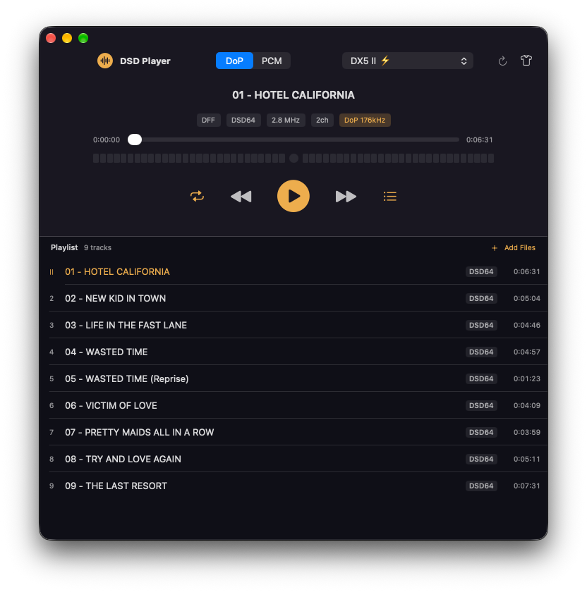
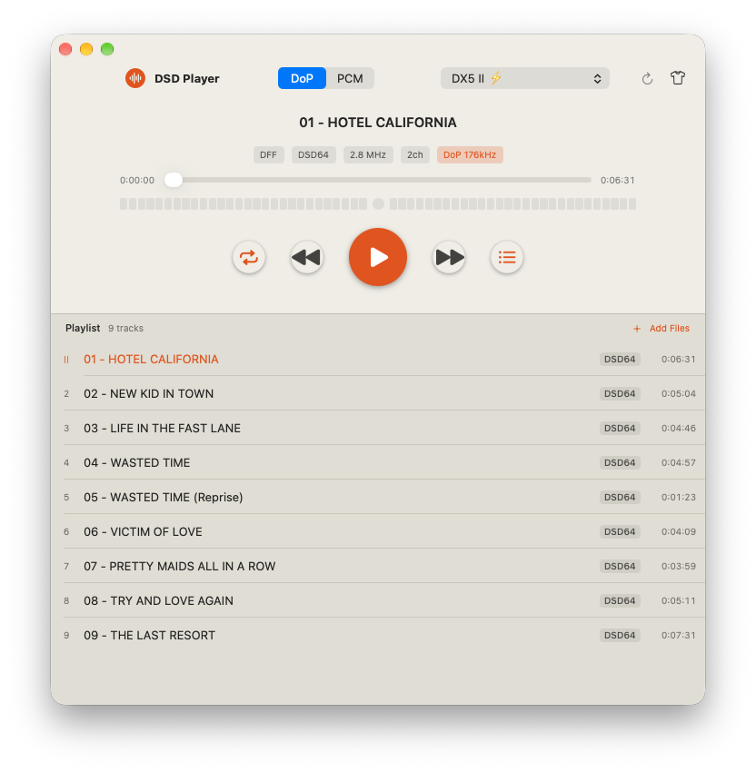
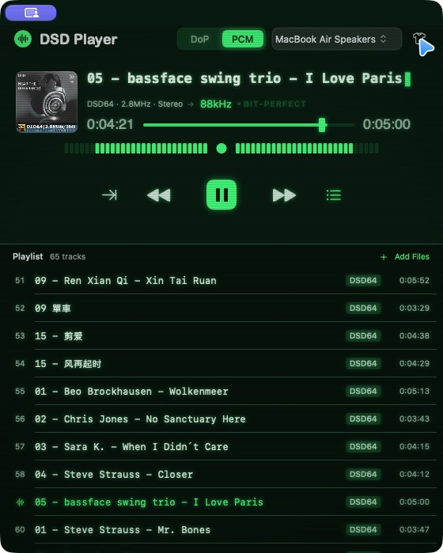

# DSD Player

A native macOS player for DSD audio files with **bit-perfect DoP output** to USB DACs, plus a real-time **DSD→PCM conversion** mode for everything else (built-in speakers, Bluetooth headphones, AirPlay). **SACD ISO** discs are supported too — including DST-compressed ones, decoded in real time.

> **Disclaimer**: This software was entirely generated by AI ([Kimi](https://www.kimi.com)) — all code, UI design, tests, documentation, and the app icon were created by AI. No human-written code. Use at your own risk; see [LICENSE](#license).

**Dark skin**



**Braun Retro skin**



**Terminal Green skin**



## Features

- **Formats**: DSF and DFF (DSDIFF) — DSD64 / DSD128 / DSD256, mono and stereo; **SACD ISO** (stereo area, both uncompressed DSD and DST-compressed frames decoded in real time)
- **DoP bit-perfect output**: raw DSD bits packed into DoP v1.1 frames, handed to the DAC untouched — exclusive (hog) mode, forced device rate/format, no mixer, no SRC. Verified on a Topping DX5 II (DAC displays DSD64/128/256)
- **DSD→PCM mode**: windowed-sinc low-pass + polyphase decimation (DSD64→88.2kHz, DSD128→176.4kHz, DSD256→352.8kHz). Works on any output device; system volume stays usable
- **PCM output rate boost**: click the rate badge in the signal chain to double or quadruple the PCM rate (up to 352.8kHz for DSD64, 1.411MHz for DSD256) — a wider anti-alias transition band means gentler filtering; switchable mid-playback without losing position
- **Playlist**: drag-and-drop files *or whole folders* (recursive scan, natural track ordering), persistent across launches, collapsible to a compact deck; multi-select with ⌘/⇧, batch delete via Delete key or context menu, ↑/↓ keyboard navigation, **drag-to-reorder** (multi-select drag moves the whole group)
- **Themed controls**: mode switch, device capsule, progress slider and selection highlight all follow the skin accent color, with hover/press feedback
- **Device resilience**: USB DAC is auto-preferred with DoP at launch; device hot-unplug/replug and macOS sleep/wake re-enumeration are handled by persistent-UID re-matching — no more stale device IDs
- **Volume hygiene**: DoP forces the device volume to 1.0 (bit-perfect requirement) and restores your previous volume on pause/stop/quit
- **Gapless playback**: same-format tracks chain without breaking the audio stream; track changes commit exactly when the boundary reaches the DAC
- **Click-free transitions**: DSD-silence padding (phase-continuous DoP markers) or PCM fade-in at play/seek/track boundaries
- **VU meters**: stereo segmented level meters around a center lamp, computed in the render callback (DSD bit-density RMS / PCM RMS), logarithmic scale, red peak zone
- **Play modes**: sequential, loop-all, repeat-one, shuffle; previous/next with smart restart
- **Skins**: Dark, Braun Retro, Terminal Green — pick from the t-shirt menu; choice persists. The Default (Dark) skin's accent and background colors are customizable, with an adjustable background transparency (15%–100%)
- **Album art**: embedded covers are read from DSF/DFF ID3v2 tags; if absent, common cover images in the song's folder (cover/front/folder/album/artwork) are used; click the artwork for a full-size preview
- **System integration**: media keys, Lock Screen / Control Center now-playing, keyboard shortcuts
  - `Space` play/pause · `←`/`→` seek ±5s · `⌘←`/`⌘→` previous/next track

## Quick Guide

1. **Add music**: drag DSD files, an album folder, **or a SACD ISO** into the window (or click **Add Files**) — an ISO expands into its track list automatically
2. **Pick the output device** in the header (USB DACs are auto-preferred and marked with ⚡)
3. **Choose the output mode**:
   - **DoP** — bit-perfect DSD to capable DACs; the DAC display should switch to DSD. *Do not touch the system volume in this mode* — any sample manipulation breaks DoP markers; use the DAC/amp volume instead
   - **PCM** — for built-in speakers / Bluetooth / anything else; system volume works normally
4. **Play**: double-click a track. The list button toggles the playlist; the window shrinks to a compact deck when hidden
5. If something needs attention (unsupported DoP carrier rate, device disconnected, unreadable files), a warning alert pops up — dismiss with OK

The playlist, current track, play mode, output mode (and PCM rate), skin, custom colors, and playlist visibility are all restored on next launch.

## Requirements

- macOS 15 or later
- For DoP mode: a USB DAC with DoP support
- No dependencies beyond system frameworks — no third-party libraries

## Install

Download `DSDPlayer.dmg` from Releases, open it, and drag **DSDPlayer.app** into **Applications**.

The app is ad-hoc signed. On first launch, if Gatekeeper blocks it: right-click the app → Open → Open.

## Build from source

```bash
swift build          # debug build
swift test           # run the unit tests (30 tests)
./build_app.sh       # release build + packaged .build/DSDPlayer.app
```

## How it works

```
DSF/DFF file ──► container parser (deinterleave + bit-order normalize)
             ──► DoP packer  (16 DSD bits + 0x05/0xFA marker per 24-bit word)
             ──► lock-free SPSC ring buffer
             ──► AUHAL render callback (real-time thread, no locks, no allocs)
             ──► USB DAC
```

- macOS CoreAudio only transports PCM, so native DSD is delivered via **DoP (DSD over PCM)**: carrier rate = DSD rate ÷ 16 (DSD64 → 176.4kHz/24-bit)
- DSF stores bits LSB-first, DFF MSB-first; both are normalized to MSB-first before DoP packing
- The feeder thread reads/decodes ahead into a ~12-second ring buffer; underruns fall back to phase-continuous DoP silence so the DAC never drops out of DSD mode

## Testing

16 unit tests cover the bit-exact paths:

- DSF/DFF parsing incl. cross-block-boundary reads
- DoP frame layout, alternating markers, stereo payload mapping
- DSD→PCM converter (full-scale DC, 440Hz tone frequency accuracy)
- VU level estimation (silence / full-scale / RMS accuracy)
- Skin enum & persistence backward compatibility
- Ring buffer wraparound

The DoP chain was additionally verified end-to-end with an offline bit-exactness check (400k frames against a real DFF rip: 0 marker errors, 0 payload mismatches) and on hardware (Topping DX5 II, DSD64/128/256).

## Known limitations

- SACD ISO: only the stereo area is played; multi-channel areas are ignored. Track titles come from the ISO's embedded text
- DST-compressed DFF files are not supported (DST in SACD ISO *is* supported)
- Multi-channel (>2ch) files are rejected
- No ID3 tag display yet (filenames are shown)
- `tools/make_test_tone.py` generates DSD test tones (DSD64/128/256, 440Hz L / 880Hz R) with a 2nd-order sigma-delta modulator — fine for link verification, not for listening tests

## License

**GPL v2** (since v1.2, due to the bundled DST decoder). The DST decoder is from [sacd-ripper](https://github.com/sacd-ripper/sacd-ripper) (libdstdec, GPL v2 / MPEG-4 reference software), compiled as the `Cdstdec` C target. ScarletBook TOC parsing (master/area TOC, track lists, track text) is implemented in Swift.
