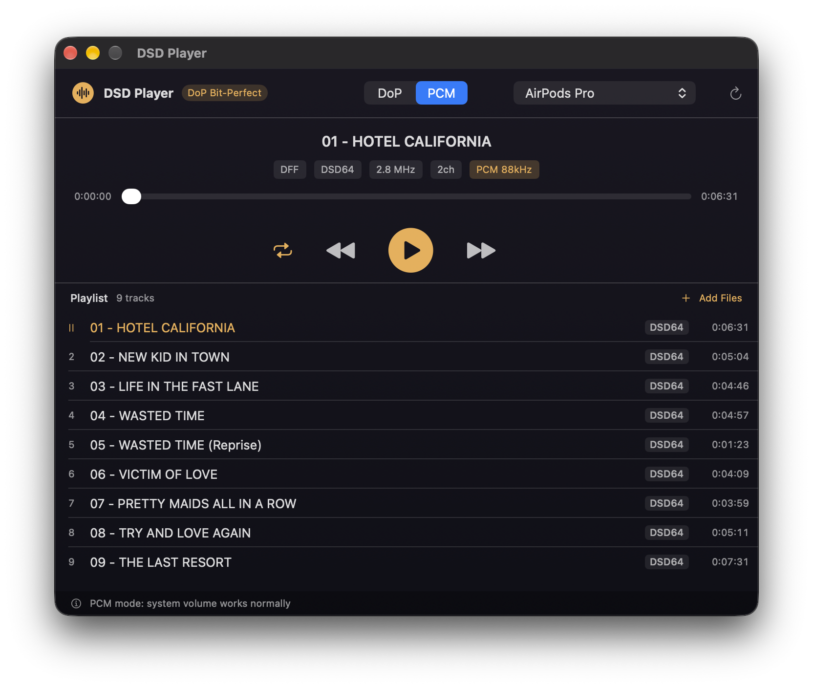

# DSD Player

A native macOS player for DSD audio files with **bit-perfect DoP output** to USB DACs, plus a real-time **DSD→PCM conversion** mode for everything else (built-in speakers, Bluetooth headphones, AirPlay).



## Features

- **Formats**: DSF and DFF (DSDIFF) files — DSD64 / DSD128 / DSD256, mono and stereo
- **DoP bit-perfect output**: packs raw DSD bits into DoP v1.1 frames and hands them to the DAC untouched — exclusive (hog) mode, forced device rate/format, no mixer, no SRC. Verified on a Topping DX5 II (DAC displays DSD)
- **DSD→PCM mode**: windowed-sinc low-pass + polyphase decimation (DSD64→88.2kHz, DSD128→176.4kHz, DSD256→352.8kHz). Works on any output, system volume stays usable
- **Playlist**: drag-and-drop files *or whole folders* (recursive scan, natural track ordering), persistent across launches
- **Gapless playback**: same-format tracks chain without breaking the audio stream; track changes commit exactly when the boundary reaches the DAC
- **Click-free transitions**: short DSD-silence padding (phase-continuous DoP markers) or PCM fade-in at play/seek/track boundaries
- **Playback modes**: sequential, loop-all, repeat-one, shuffle; previous/next with smart restart (first 3 seconds)
- **System integration**: media keys, Lock Screen / Control Center now-playing, keyboard shortcuts
  - `Space` play/pause · `←`/`→` seek ±5s · `⌘←`/`⌘→` previous/next track

## Requirements

- macOS 15 or later (Apple Silicon recommended)
- For DoP mode: a USB DAC with DoP support
- No dependencies beyond the system frameworks — no third-party libraries

## Build

```bash
swift build          # debug build
swift test           # run the unit tests (10 tests)
./build_app.sh       # release build + packaged DSDPlayer.app in .build/
```

## Usage

1. Drag DSD files or an album folder into the window (or click **Add Files**)
2. Pick the output device (USB DACs are auto-preferred and marked with ⚡)
3. Choose the output mode:
   - **DoP** — bit-perfect DSD to capable DACs. The DAC display should switch to DSD. *Do not touch the system volume in this mode* — any sample manipulation breaks DoP markers; use the DAC/amp volume instead
   - **PCM** — for built-in speakers / Bluetooth / anything else; system volume works normally
4. Double-click a track to play

The playlist, current track, play mode, and output mode are restored on next launch.

## How it works

```
DSF/DFF file ──► container parser (deinterleave + bit-order normalize)
             ──► DoP packer  (16 DSD bits + 0x05/0xFA marker per 24-bit word)
             ──► lock-free SPSC ring buffer
             ──► AUHAL render callback (real-time thread, no locks, no allocs)
             ──► USB DAC
```

- macOS CoreAudio only transports PCM, so native DSD is delivered via **DoP (DSD over PCM)**: carrier rate = DSD rate ÷ 16 (DSD64 → 176.4kHz/24-bit)
- DSF stores bits LSB-first, DFF MSB-first; both are normalized to MSB-first before DoP packing
- The feeder thread reads/decodes ahead into a ~12-second ring buffer; underruns fall back to phase-continuous DoP silence so the DAC never drops out of DSD mode

## Testing

The unit tests cover the bit-exact paths:

- DSF/DFF parsing incl. cross-block-boundary reads
- DoP frame layout, alternating markers, stereo payload mapping
- DSD→PCM converter (full-scale DC, 440Hz tone frequency accuracy)
- Ring buffer wraparound

The DoP chain was additionally verified end-to-end with an offline bit-exactness check (400k frames against a real DFF rip: 0 marker errors, 0 payload mismatches) and on hardware (Topping DX5 II).

## Known limitations

- DST-compressed DFF and SACD ISO are not supported
- Multi-channel (>2ch) files are rejected
- No ID3 tag display yet (filenames are shown)
- `tools/make_test_tone.py` generates a DSD64 stereo test tone (440Hz L / 880Hz R) with a simple 2nd-order sigma-delta modulator — it has a modest in-band noise floor by design, fine for link verification, not for listening tests

## License

MIT
